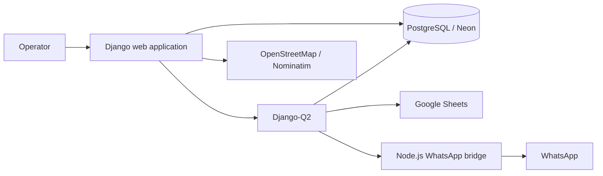

# VentaStockManager

Production Django platform for managing inventory, sales, customer accounts, price lists, deliveries, and operational messaging for a retail and distribution business.

The system is actively maintained and deployed on Render. It has separate staging and production environments and is used with real business data, so there is no public demo or shared production access.

## Why this project matters

VentaStockManager started from an existing codebase and evolved into a production system through substantial independent development. The maintained implementation lives on the [`production`](https://github.com/jairoDO/VentaStockManager/tree/production) branch; the default `main` branch remains the legacy baseline while the deployment migration is completed.

The project demonstrates ownership beyond feature implementation: domain modeling, data migrations, background processing, third-party integrations, operational documentation, environment separation, deployment, and production maintenance.

## Main capabilities

- Product catalog, categories, stock thresholds, suppliers, and spreadsheet imports
- Sales, purchases, customer accounts, payments, and daily cash reporting
- Customer-specific pricing and shareable price lists
- Delivery assignment and route planning
- Google Sheets synchronization for operational product data
- WhatsApp messaging and campaign workflows through an isolated Node.js service
- Scheduled and asynchronous jobs for notifications, maintenance, and data synchronization
- Audit logging for sensitive business operations
- Runtime configuration for operational settings

## Architecture



| Area | Technology |
| --- | --- |
| Application | Python 3.11, Django 4.2 |
| Database | PostgreSQL on Neon; SQLite fallback for local development |
| Background work | Django-Q2 with scheduled and asynchronous tasks |
| Messaging | Node.js, Express, and Baileys in a private service |
| Integrations | Google Sheets, OpenStreetMap/Nominatim, WhatsApp |
| Delivery | Docker for local development; Render for staging and production |
| Operations | Gunicorn, WhiteNoise, health checks, audit logging |

## Repository branches

| Branch | Purpose |
| --- | --- |
| `main` | Legacy baseline inherited from the original project |
| `staging` | Render staging environment and pre-production validation |
| `production` | Current production code and deployment source |

New portfolio and documentation work should branch from `production` until the legacy migration is closed and the branch strategy is simplified.

## Local development

### Python environment

```bash
python3.11 -m venv .venv
source .venv/bin/activate
pip install -r requirements.txt
cp .env.example .env
cd VentaStockManager
python manage.py migrate
python manage.py createsuperuser
python manage.py runserver
```

The default local database is SQLite. External integrations require their own environment variables and credentials; never commit real credentials or production database URLs.

### Docker Compose

The repository also includes a Docker Compose stack for Django, PostgreSQL, the Django-Q2 worker, and the optional WhatsApp bridge.

```bash
docker compose up --build
```

Before enabling Google Sheets locally, update the credentials mount in `docker-compose.yml` to point to a credential file stored outside the repository.

## Tests and validation

The repository currently contains 17 Python test modules with unit and integration coverage across inventory, pricing, customers, sales, delivery routes, background work, and WhatsApp workflows.

```bash
cd VentaStockManager
python manage.py test
```

The WhatsApp bridge has its own Node.js tests:

```bash
cd wa-bot
npm install
npm test
```

Documentation freshness can be checked with:

```bash
python3 docs/check_docs_staleness.py
```

## Documentation

- [`docs/MANUAL_OPERADOR.md`](docs/MANUAL_OPERADOR.md): Spanish-language operator manual
- [`docs/venta-behavior.md`](docs/venta-behavior.md): behavioral baseline for the sales workflow
- [`docs/operations/background-worker.md`](docs/operations/background-worker.md): background-worker operations
- [`wa-bot/README.md`](wa-bot/README.md): messaging bridge setup and operational notes

## Security and privacy

- Production secrets are configured in Render and are not committed to the repository.
- Local `.env` files, credential files, database files, and generated media are ignored by Git.
- The public repository must not contain exports from production, real customer records, or private credentials.
- Production access is not shared. A technical walkthrough can use sanitized screenshots and architecture documentation.

## Project status

Actively maintained. The immediate repository work is to improve public documentation, complete a security/privacy review, and simplify the branch strategy without disrupting the Render deployment.
